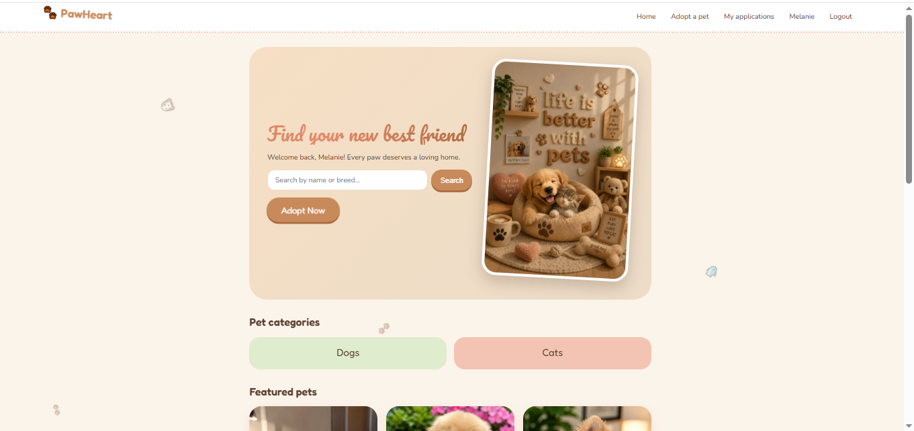
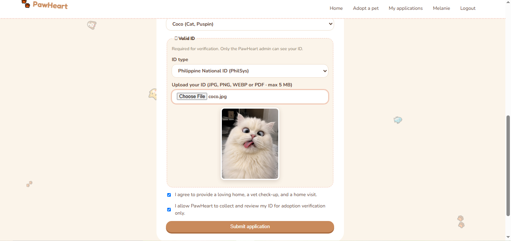
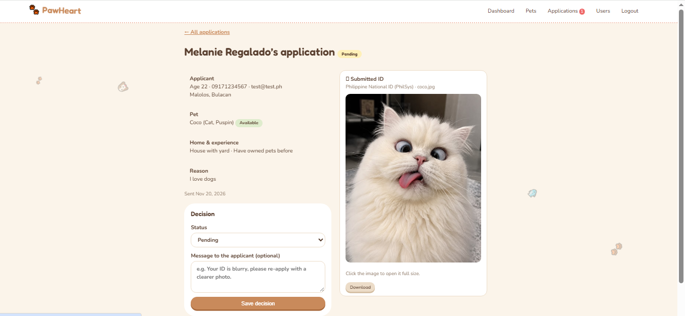

# PawHeart Pet Adoption System

Web-based pet adoption system built with PHP and MySQL.

## Features
- User registration, login and logout (hashed passwords)
- Browse and search pets by species, age, gender and location
- Adoption application with valid ID upload
- Admin can view the submitted ID, approve or reject applications
- Admin can manage pets and users

## Requirements
- XAMPP (Apache, PHP, MySQL)

## Installation
1. Copy this folder to htdocs.
2. Start Apache and MySQL in XAMPP.
3. Open phpMyAdmin, select the pawheart database (or create it) and import database.sql.
4. Open http://localhost/PET_ADOPTION_SYSTEM/

## Technologies
PHP, MySQL, HTML, CSS, JavaScript, Git and GitHub

## Screenshots

### Home page

### Adoption form with ID upload

### Admin viewing the submitted ID

